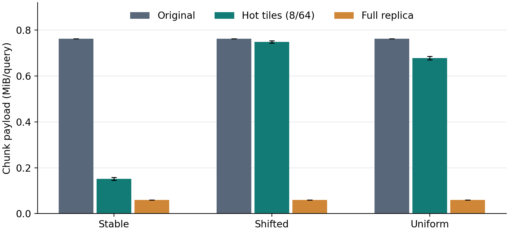
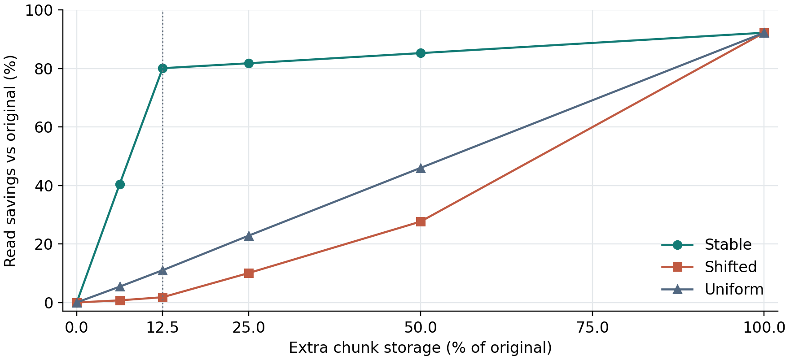
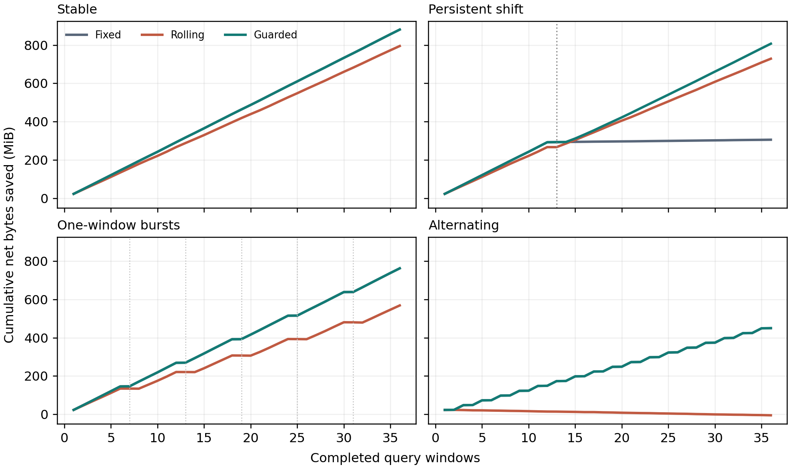
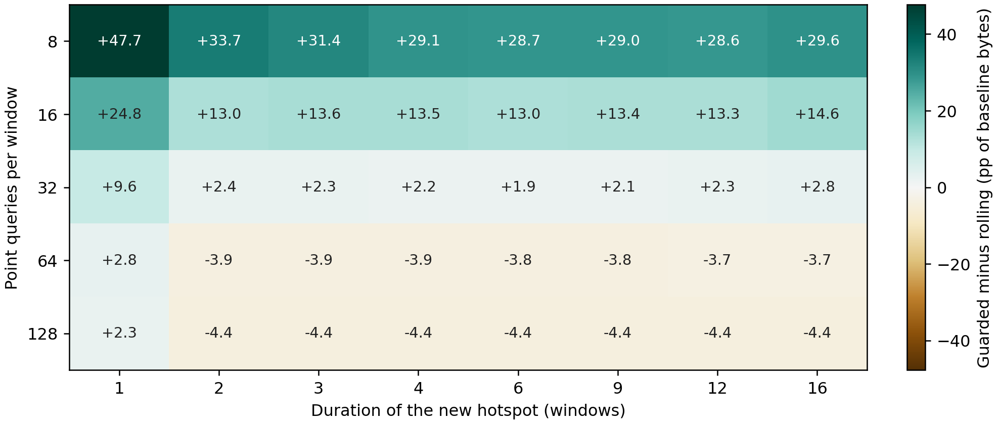

# 面向海温单点长序列查询的热点局部重分块实验

同一份海表温度网格同时服务单月整图和单点长序列查询。本实验比较三种布局，检验只给常查海区建立长序列副本能省多少块读取量，以及热点转移时会损失多少收益。

## 报告与复现入口

- [实验报告](面向海温单点长序列查询的热点局部重分块实验_周琪_12634053.docx) 
- [Markdown 协作记录](AI_DIALOGUE.md) 
- [仿真与本地 Zarr 校验脚本](src/replay.py)
- [按随机种子回放的数据](results/replay.csv) · [本地 Zarr 校验记录](results/zarr_audit.json)
- [动态副本实验脚本](src/adaptive.py) · [逐窗记录](results/adaptive_windows.csv) · [动态汇总和增量建设校验](results/adaptive_summary.json) · [灵敏度数据](results/duration_sensitivity.csv)

## 实验结果

原始布局平均每次读 0.763 MiB。全量副本额外增加 100% 的块存储，平均每次读 0.059 MiB。局部副本只增加 12.5% 的块存储。

| 测试负载 | 局部副本单点命中率 | 局部副本平均读量 | 相对原始布局少读 |
| --- | ---: | ---: | ---: |
| 热点稳定 | 86.85% | 0.152 MiB/次 | 80.09% |
| 热点转移 | 1.94% | 0.749 MiB/次 | 1.79% |
| 均匀访问 | 11.95% | 0.678 MiB/次 | 11.02% |





## 连续回放与重建成本

动态实验用 30 个种子，在 36 个连续窗口内比较原布局、固定 8 区、滚动更新、确认并回本、两个消融方案和全量双布局。所有更新只看已经结束的窗口，净节省量已扣除初次建设和后续新增块的读写载荷。

| 访问场景 | 固定 | 直接滚动 | 确认并回本 |
| --- | ---: | ---: | ---: |
| 热点稳定 | 80.20% | 72.38% | 80.20% |
| 持续迁移 | 27.84% | 66.35% | 73.48% |
| 单窗突发 | 69.40% | 51.76% | 69.40% |
| 逐窗交替 | 40.92% | −0.46% | 40.98% |
| 均匀访问 | 11.40% | −0.06% | 10.92% |

持续迁移时，确认并回本比直接滚动多省 7.13 个百分点，配对自助 95% 区间为 6.43–7.82；平均重建窗口数从 29.67 降到 2.43。在每窗 128 条单点、热点只迁移两窗的设定下，直接滚动反而多省 4.37 个百分点。





## 运行方法

在仓库根目录执行以下命令。验证环境为 Python 3.14.2。

```bash
python -m pip install -r requirements.txt
python src/replay.py
python src/adaptive.py
```

脚本自行生成 240×64×64 的合成海温数组和查询，无需下载数据。它写入临时 Zarr v2 数组，核验 201 次查询的数值与读块量，再在 `results/` 生成 216 行回放结果、校验 JSON 和两张图。回放使用种子 4101–4112。JSON 中的建设用时为单次本地实测，会随机器和运行状态变化。

`replay.csv` 每行对应一个种子、访问场景和局部副本预算。`query_payload_bytes` 为该轮 800 条查询的块载荷总量，`full_savings_retained_pct` 为局部方案节省量占相同查询下全量副本节省量的比例。仿真用无压缩块载荷衡量读量，结论适用于给定的合成负载与布局。

`adaptive_windows.csv` 有 37,800 行，记录每种策略在各窗的命中数、查询字节、建设读写和净收益。`duration_sensitivity.csv` 有 1,200 行，记录 40 个参数组合的 30 次配对回放。增量建设另外用本地 Zarr 核验 24 次单点查询。相同数量的新增分区分散到四个原空间块时，建设读取量从 0.938 MiB 增至 3.750 MiB。字节口径未计入删块、索引、缓存、压缩和暂存开销。

目录采用 README 入口、独立 Markdown 对话、报告与实验产物可分别查阅的组织方式。布局参考只查看了两个同课程公开仓库的文件清单。 [目录参考一](https://github.com/contrjsdfs/Marine-Data-Mining-Technology) · [目录参考二](https://github.com/qeffad/Data-Mining-Technology-HomeWork)
